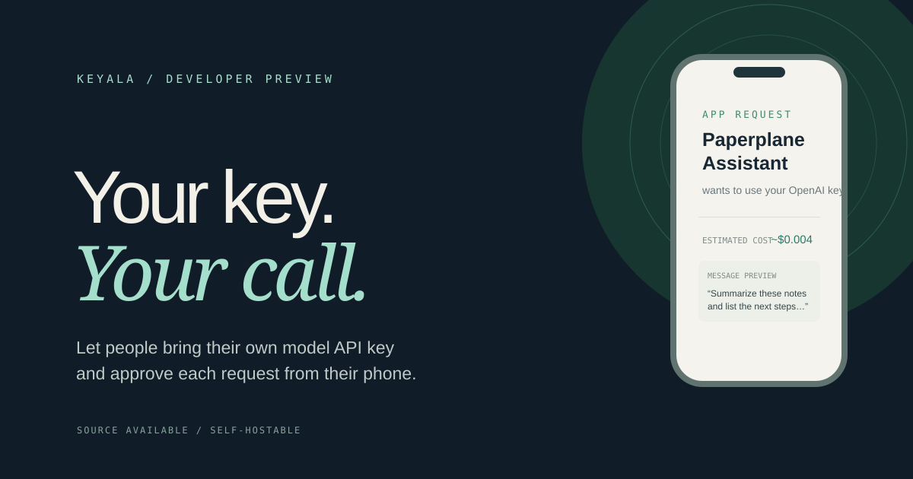
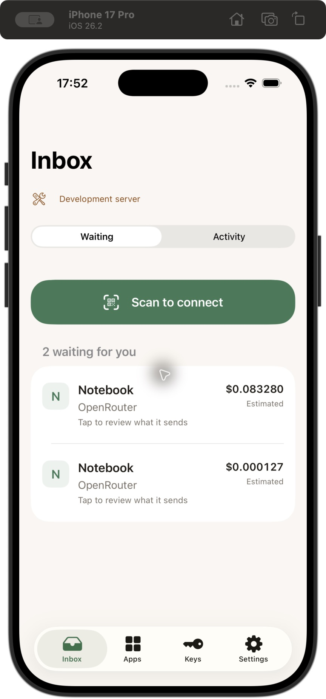
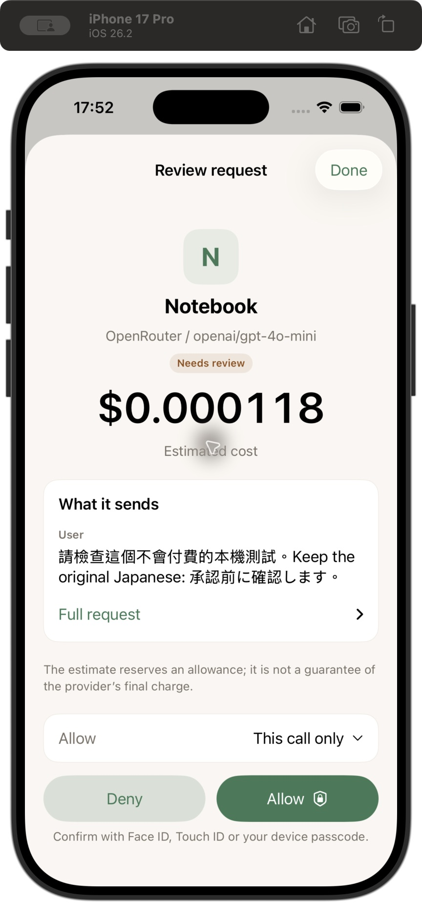

# Keyala

### Your key. Your call.

[](https://iamjoseph331.github.io/Keyala/)

Build AI tools people can try without handing you their API keys.

Keyala sits between an AI app and its model provider. The developer sends a
request. The user sees the full prompt and estimated cost on their iPhone, then
decides whether it can run. Keyala calls the provider with the user's stored
key and records the response for both sides to inspect.

**The developer gets a response. The user keeps control of their key.**

Keyala is an experimental personal project operated by **Joseph Chen**. I am
actively developing it, testing the complete approval flow and documenting its
limits. It is an early service with no uptime or immediate-support guarantee.
Start with a separate, restricted provider key and a small provider-side spending
limit where available. The beta is free; model usage is billed by your provider.

[Privacy & data](https://iamjoseph331.github.io/Keyala/privacy/) | [Help & contact](https://iamjoseph331.github.io/Keyala/support/) | [Email Joseph](mailto:josephchen637@gmail.com)

[Try the interactive demo](https://iamjoseph331.github.io/Keyala/) | [Architecture and API contract](docs/PLAN.md) | [iOS app](ios/)

> Working MVP. Native iOS pairing, approval, denial, and response inspection are
> tested against the Rust server with a mock provider. Production uses a persistent
> disk; a pending connection survived deployment on 2026-11-19, and an automatic
> SQLite backup passed a separate restore check. Daily backups retain seven copies
> on the same disk; off-disk disaster recovery remains unverified. Staging uses Free compute with no disk and resets on restart. Live OpenRouter consent, provider billing
> and APNs delivery still require end-to-end verification.

## OpenRouter credits for OpenAI and Anthropic apps

In the iOS app, **Settings > OpenRouter credits** can route new OpenAI and
Anthropic app connections through your OpenRouter account. It is **off by default**.
Connect OpenRouter in Keys first. Pairing and request review show the billing
provider and mapped model. Existing connections keep their original route;
disconnect and reconnect to change it. Only the allowlisted text-only models and
options are supported. Charges follow OpenRouter, not a ChatGPT or Claude
subscription. The settings guide can be hidden and reopened.

## Start building

[Developer console](https://iamjoseph331.github.io/Keyala/developers/) creates an app token and opens app-scoped usage reports. [Tutorials](https://iamjoseph331.github.io/Keyala/tutorials/) walk through app registration, phone approval, provider requests, and a browser integration.

## Try the local demo

You need Rust, Node.js 20+, Xcode for the iOS app, and `curl`, `jq`, and `openssl`.

```sh
git clone https://github.com/iamjoseph331/Keyala.git
cd Keyala
bash sdk/demo.sh
```

The script starts a disposable SQLite database with a fake provider key and mock
responses. It prints the exact command for starting the example chat app in a
second terminal. No real provider credits are used.

Open [the iOS project](ios/Keyala/Keyala.xcodeproj) in Xcode and run it in a
simulator. Open **Settings → Developer options**, enable developer options, leave
**Use sample data** off, enable **Allow HTTP for localhost**, and select the custom
server `http://localhost:8080`. Sign in as `demo@keyala.dev` through
**Development sign-in**. Connect from the
chat example, scan its connection QR on the phone, then inspect and approve its request.
See [iOS setup](ios/README.md) for signing and simulator-runtime notes.

Without Xcode, `bash sdk/demo.sh --simulate-phone` runs a script that plays the
phone's part. That tests the backend and developer flow; it is not an iOS test.
The example is a local, single-user demonstration, not a deployable multi-user
application.

## Example apps

[Resume Tailor](examples/resume-tailor/) is a static browser app that tailors a resume to a job description. Visitors connect OpenAI, Anthropic or OpenRouter through Keyala and choose a supported model. The site operator needs neither a vendor key nor a separate app server. [Try Resume Tailor](https://iamjoseph331.github.io/Keyala/examples/resume-tailor/)

## On the iPhone

Fresh installs show a three-step guide covering the operator trust boundary,
provider billing, connection and request review. Reopen it from **Settings →
Getting started**. Continuing with Apple creates an account for a new user and
signs a returning user into the same account; no separate Keyala password is
needed. Fresh installs use the built-in production address. The app has Inbox, Apps, Keys
and Settings tabs. Scan an app's connection QR, check the source, and review the
prompt and estimated cost before allowing a call. Sample data and server overrides
sit under Settings → Developer options.

Keys offers one-tap OpenRouter authorization, using an OpenRouter account and its
own credits. For OpenAI or Anthropic, open the Keyala server's `/add-key` page
on a computer, scan its setup QR, paste there and confirm on the phone. Direct
paste on the phone remains available with provider-specific format hints. The
phone's import review never downloads the full key.

## From the running iOS app

The redesigned Inbox and review sheet below ran against the local Rust mock
server. The identities, prompts and keys are fictional QA data.




```text
Your AI app             Keyala                  User's iPhone
    |                      |                            |
    |  model request       |                            |
    |--------------------->|  exact payload + estimate   |
    |                      |--------------------------->|
    |                      |          approve / deny    |
    |                      |<---------------------------|
    |                      |
    |                      |  approved request + user's key
    |                      |-------------------------------> Model provider
    |                      |<------------------------------- response + usage
    |     response         |                            |
    |<---------------------|   request/response history   |
    |                      |--------------------------->|
```

## Approval that fits the task

| Permission | User's intent |
| --- | --- |
| Once | Let this exact request run. |
| Count | Allow a limited number of calls from this app. |
| Budget | Allow requests while a spending allowance remains. |
| Trust with alerts | Allow this app to run and notify me about spending. |

Users can inspect prompts, review responses, and revoke an app's access. History
paging keeps older calls available beyond the first page. An
approval covers what Keyala will send to the provider. It cannot verify every
claim an app makes about why it wants the result, and developers can retain
responses they receive.

## Designed for solo developers

The integration uses an app-scoped connection token in place of a vendor
key and a Keyala base URL. The developer never receives the user's vendor key.
The backend supports bounded, non-streaming OpenAI, Anthropic and OpenRouter text
requests. OpenRouter uses `/v1/openrouter` with its own exact model slugs and
provider-specific grants. Unsupported request options fail visibly.

```python
# Integration shape. Pair the user first to obtain a scoped grant token.
# Do not put a vendor API key in your application.
from openai import OpenAI

client = OpenAI(
    base_url="http://localhost:8080/v1/openai",
    api_key=keyala_grant_token,
    max_retries=0,
)
```

A request awaiting human approval can return HTTP 202 after the wait window.
Official vendor SDKs do not inherently handle that approval workflow: the
Keyala wrapper must poll the request ID. See the [shared contract](docs/PLAN.md)
before integrating. Disable SDK automatic retries: after an uncertain outcome,
inspect the existing request instead of submitting another chargeable call.
Streaming is outside the first version.

## A small, self-hostable foundation

| Component | Stack | Owner |
| --- | --- | --- |
| Approval server and persistence | Rust, Axum, SQLite | Claude Code |
| User app | SwiftUI, iOS 17+ | Codex |
| Developer integration | Official vendor SDK compatibility and Node chat example | Claude Code |
| Developer page | Static HTML, CSS, JavaScript on GitHub Pages | Codex |

The project is being built in public by Joseph Chen with Codex and Claude Code.
The shared [agent rules](AGENTS.md) and [implementation plan](docs/PLAN.md) keep
ownership, interface decisions, and resource limits explicit.

## The trust boundary

Keyala removes the need to share a vendor key with each app developer. It
does introduce a service users must trust: the Keyala operator. The server
needs to decrypt keys to make provider calls. Encryption at rest protects a
database copy; it does not hide keys from an operator who controls the running
server and its master encryption key.

Self-hosting makes that boundary yours to operate. Before putting real keys in
any deployment, review authentication, key management, request visibility,
retention, and the implementation's documented limitations. Use separate,
restricted provider keys where available.

The server stores prompts, responses, permissions and usage history for later
inspection; there is no automatic history expiration. Allowed requests go to the
selected provider, and the calling app receives the response and may keep a copy.
Removing a provider key or app permission does not erase those external copies.

**Settings → Account** separates signing out this device, signing out other
devices, stopping all app permissions and deleting the account. Account deletion
requires fresh identity verification and removes the live account, stored keys,
permissions and history. It does not close provider accounts or cancel their
subscriptions. Backups can contain older copies until expiration; operators must
replay deletion records before serving a restored database. See the [operations
runbook](docs/ops/RUNBOOK.md) for the configured backup and recovery procedure.

Cost estimates are estimates, not a provider-enforced monetary guarantee.
Reservations, token limits, pricing snapshots, and vendor-reported actual usage
serve different purposes and must remain distinguishable.

## Build with us

Start with the [plan and API contract](docs/PLAN.md). Report a concrete integration
need or a reproducible problem in [GitHub Issues](https://github.com/iamjoseph331/Keyala/issues).
Never include real API keys, session tokens, or private prompts in an issue,
screenshot, or pull request.

## License

[Apache License 2.0](LICENSE). Copyright 2026 Joseph Chen.
