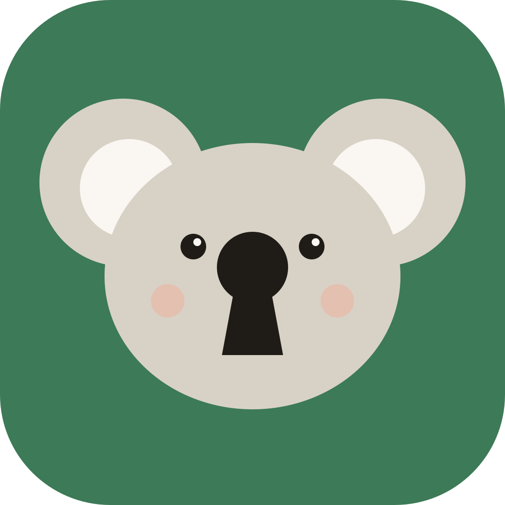
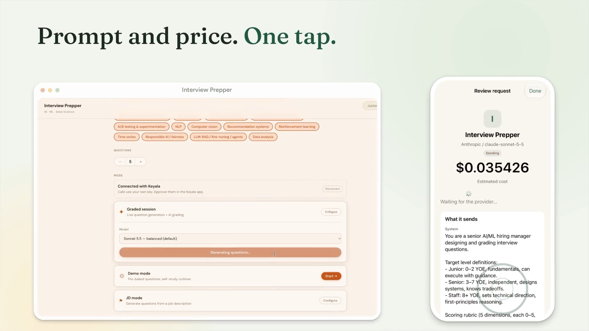
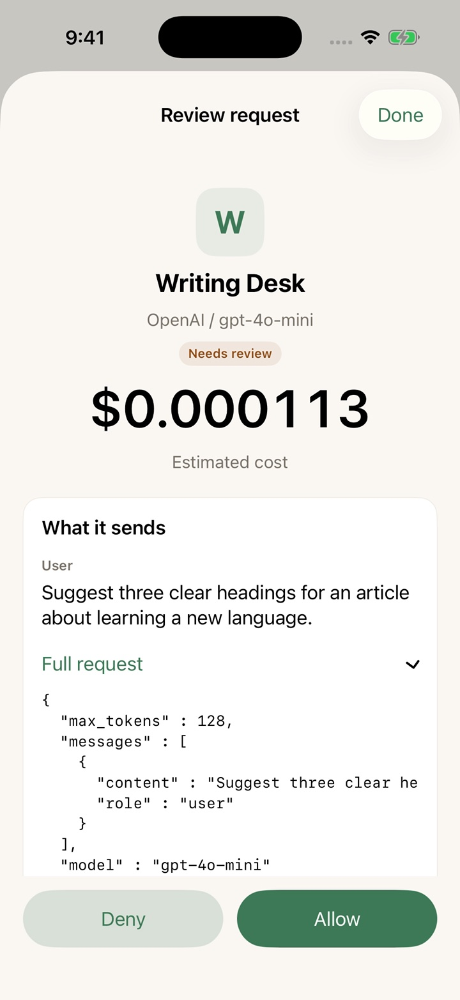
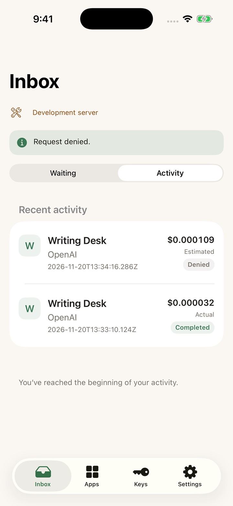
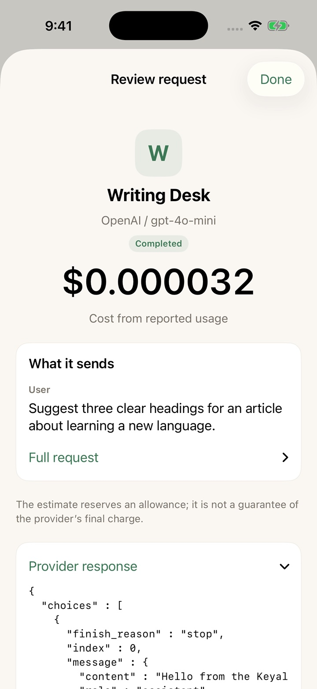

<a id="readme-top"></a>

<p align="center">
  <a href="https://keyala.io/">
    
  </a>
</p>

<h1 align="center">Keyala</h1>

<p align="center">
  <strong>Your key. Your call.</strong><br>
  <em>AI apps should not have to guess who pays for the model. With Keyala, users bring their own<br>
  OpenAI, Anthropic or OpenRouter key and approve every call on their iPhone.</em>
</p>

<p align="center">
  <a href="https://keyala.io/"></a>
  <a href="https://app.keyala.io/console"></a>
  
  
</p>
<p align="center">
  <a href="https://keyala.io/docs/"></a>
  <a href="https://keyala.io/guide/"></a>
  <a href="https://keyala.io/news/"></a>
  <a href="LICENSE"></a>
</p>

<p align="center">
  
  
  
  
  
  
</p>

<p align="center">
  <a href="#-the-problem">The problem</a> |
  <a href="#-how-it-works">How it works</a> |
  <a href="#-for-developers">Developers</a> |
  <a href="#-for-users">Users</a> |
  <a href="#-example-apps">Examples</a> |
  <a href="#-run-it-locally">Run locally</a> |
  <a href="#-trust-and-data">Trust and data</a> |
  <a href="#-documentation-map">Docs</a>
</p>

<p align="center">
  <a href="https://keyala.io/media/keyala-launch-16x9.mp4">
    
  </a><br>
  <sub>▶ <a href="https://keyala.io/media/keyala-launch-16x9.mp4">Watch Keyala in 30 seconds</a></sub>
</p>

---

## 💡 The problem

You built an AI tool. Who provides the API key?

- **You pay** for every visitor, and one popular day burns your budget.
- **Visitors paste their key** into your page, and have to trust you with it forever.

Keyala is the third option. The user's key stays in Keyala. Your app gets a scoped
grant token. Every call shows up on the user's phone with the full prompt and an
estimated cost, and runs only if they allow it.

## 🔁 How it works

```text
Your AI app             Keyala                     User's iPhone
    |                      |                              |
    |  model request       |                              |
    |--------------------->|  full prompt + estimate      |
    |                      |----------------------------->|
    |                      |           allow / deny       |
    |                      |<-----------------------------|
    |                      |  allowed request + user's key
    |                      |-------------------------------> Model provider
    |                      |<------------------------------- response + usage
    |     response         |   prompt, response, cost     |
    |<---------------------|----------------------------->|
```

1. **Pair once.** The app shows a QR code (or an "Open Keyala" button on a phone). The user scans it and approves the connection.
2. **Review each call.** The phone shows who is asking, what will be sent and what it should cost.
3. **Allow or deny.** Keyala calls the provider with the user's key and both sides see the response.

## 🛠 For developers

**Easy.** Keep the official OpenAI or Anthropic SDK. Change the base URL, use the grant token as the API key.

```python
from openai import OpenAI

client = OpenAI(
    base_url="https://app.keyala.io/v1/openai",
    api_key=grant_token,   # from pairing, never a vendor key
    max_retries=0,         # an uncertain call is polled, never resent
)
```

**Browser apps need no server.** One script tag, one call:

```html
<script src="https://app.keyala.io/sdk/keyala.js"></script>
<script>
  const { grant_token } = await Keyala.connect({ app: "app_...", vendor: "anthropic" });
</script>
```

**Analytics included.** The [web console](https://app.keyala.io/console) lists your apps and shows
requests, cost, models, countries and busy hours for each one.

**Free.** No key to buy, no bill to forward. Users pay their own provider.

Start with the [developer docs](https://keyala.io/docs/) (also as [Markdown](site/docs/keyala.md) for your AI assistant)
and the [API contract](docs/PLAN.md).

## 📱 For users

<p align="center">
  
  &nbsp;
  
  &nbsp;
  
</p>
<p align="center"><sub>Screens from the iOS app running against a local mock server. Apps, prompts and keys are fictional.</sub></p>

- **Intuitive.** Scan a QR code to connect an app. Tap Allow or Deny.
- **Transparent.** Read the full prompt before it runs and the full response after.
- **Your limits.** Approve once, a set number of calls, a budget, or trust with alerts. Revoke any time.
- **Safer by design.** Apps never see your key. A new app starts on ask-every-time. Web sign-ins are read-only.

**Providers.** Add an OpenAI or Anthropic key from your computer at
[app.keyala.io/add-key](https://app.keyala.io/add-key) (scan, paste, confirm on the phone),
or connect OpenRouter with one tap. **Settings > OpenRouter credits** (off by default) routes new
OpenAI and Anthropic connections through your OpenRouter account.

The [user guide](https://keyala.io/guide/) walks through sign-up, keys, routing and the web console
in English, 繁體中文 and 日本語.

## 🧪 Example apps

| App | What it does | Try it |
|:---|:---|:---|
| [**Resume Tailor**](examples/resume-tailor/) | Tailors a resume to a job description. Static page, no app server, any of the three providers. | [keyala.io/examples/resume-tailor](https://keyala.io/examples/resume-tailor/) |
| [**Interview Prepper**](https://github.com/iamjoseph331/interview_prepper) | AI/ML mock interviews: Claude writes questions and grades answers. "Connect Keyala" replaces the key field. | [Live on GitHub Pages](https://iamjoseph331.github.io/interview_prepper/) |

## 🚀 Run it locally

You need Rust, Node.js 20+, `curl`, `jq` and `openssl` (Xcode for the iOS app).

```sh
git clone https://github.com/iamjoseph331/Keyala.git
cd Keyala
bash sdk/demo.sh --simulate-phone
```

This starts a throwaway server with a fake key and a mock provider, so no credits are spent.
`--simulate-phone` plays the phone's part. To use the real iOS app instead, drop the flag, open
[the Xcode project](ios/Keyala/Keyala.xcodeproj), turn on **Settings > Developer options**, point it at
`http://localhost:8080` and sign in as `demo@keyala.dev`. See [iOS setup](ios/README.md).

## 🔒 Trust and data

Keyala removes the need to give your key to every app developer. It does ask you to trust
the Keyala operator: the server must decrypt a key to call the provider.

- Keys and request content are encrypted at rest, prompts and responses with a per-user key.
- Prompt and response content is deleted 30 days after a request finishes; usage metadata stays.
- The calling app receives the response and may keep it. Revoking access does not erase its copy.
- **Settings > Account** signs out devices, stops all app permissions, or deletes the account after fresh verification.
- Cost shown before a call is an estimate. Cost after a call comes from provider-reported usage.

Keyala is an experimental personal project run by Joseph Chen, with no uptime guarantee.
Use a separate, restricted provider key with a small spending limit. Details:
[privacy](https://keyala.io/privacy/), [support](https://keyala.io/support/), [support@keyala.io](mailto:support@keyala.io).
Self-hosting moves that trust to you; see the [backup](docs/ops/backup.sh), [deletion replay](docs/ops/replay-deletions.sh)
and [restore check](docs/ops/restore-drill.sh) scripts.

## 🗺 Documentation map

| Need | Go to |
|:---|:---|
| Integrate an app | [Developer docs](https://keyala.io/docs/), [Markdown copy](site/docs/keyala.md) |
| Exact API contract | [docs/PLAN.md](docs/PLAN.md) |
| Use the iPhone app | [User guide](https://keyala.io/guide/) |
| Build the iOS app | [ios/README.md](ios/README.md) |
| What's next | [Roadmap (繁體中文)](roadmaps.md), [News](https://keyala.io/news/) |
| How agents collaborate here | [AGENTS.md](AGENTS.md) |

## 🤝 Build with us

Keyala is built in public by Joseph Chen with Claude Code (Rust server, SDK, website) and Codex (iOS app).
Report an integration need or a reproducible bug in [GitHub Issues](https://github.com/iamjoseph331/Keyala/issues).
Never include real API keys, session tokens or private prompts in an issue, screenshot or pull request.

## 📄 License

[Apache License 2.0](LICENSE). Copyright 2026 Joseph Chen.

<p align="right"><a href="#readme-top">Back to top</a></p>
