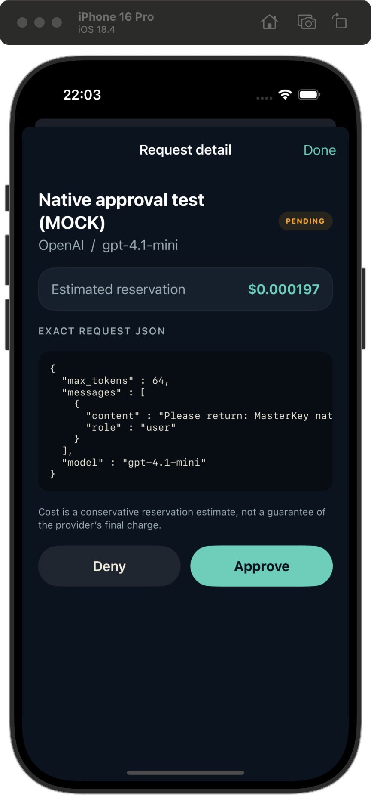
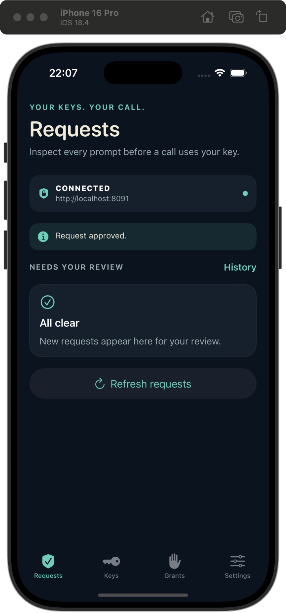

# MasterKey

### Your key. Your call.

[](https://iamjoseph331.github.io/MasterKey/)

Build AI tools people can try without handing you their API keys.

MasterKey sits between an AI app and its model provider. The developer sends a
request. The user sees the full prompt and estimated cost on their iPhone, then
decides whether it can run. MasterKey calls the provider with the user's stored
key and records the response for both sides to inspect.

**The developer gets a response. The user keeps control of their key.**

[Try the interactive demo](https://iamjoseph331.github.io/MasterKey/) | [Architecture and API contract](docs/PLAN.md) | [iOS app](ios/)

> Working MVP. Native iOS pairing, approval, denial, and response inspection are
> tested against the Rust server with a mock provider. Hosted services currently
> use ephemeral storage: keys, grants, and history reset on restart. Live provider
> billing and APNs delivery still require end-to-end verification.

## Start building

[Developer console](https://iamjoseph331.github.io/MasterKey/developers/) creates an app token and opens app-scoped usage reports. [Tutorials](https://iamjoseph331.github.io/MasterKey/tutorials/) walk through app registration, phone approval, both model providers, and a browser integration.

## Try the local demo

You need Rust, Node.js 20+, Xcode for the iOS app, and `curl`, `jq`, and `openssl`.

```sh
git clone https://github.com/iamjoseph331/MasterKey.git
cd MasterKey
bash sdk/demo.sh
```

The script starts a disposable SQLite database with a fake provider key and mock
responses. It prints the exact command for starting the example chat app in a
second terminal. No real provider credits are used.

Open [the iOS project](ios/MasterKey/MasterKey.xcodeproj) in Xcode and run it in a
simulator. Open **Settings → Developer options**, enable developer options, leave
**Use sample data** off, enable **Allow HTTP for localhost**, and select the custom
server `http://localhost:8080`. Sign in as `demo@masterkey.dev` through
**Development sign-in**. Connect from the
chat example, review its code on the phone, then inspect and approve its request.
See [iOS setup](ios/README.md) for signing and simulator-runtime notes.

Without Xcode, `bash sdk/demo.sh --simulate-phone` runs a script that plays the
phone's part. That tests the backend and developer flow; it is not an iOS test.
The example is a local, single-user demonstration, not a deployable multi-user
application.

## Example apps

[Resume Tailor](examples/resume-tailor/) is a static browser app that tailors a resume to a job description. Visitors connect their own OpenAI or Anthropic key through MasterKey and choose a supported model. The site operator needs neither a vendor key nor a separate app server. [Try Resume Tailor](https://iamjoseph331.github.io/MasterKey/examples/resume-tailor/)

## From the running iOS app

The native inspector below is connected to the local Rust server. The provider
is mocked, and the prompt is test data.




```text
Your AI app             MasterKey                  User's iPhone
    |                      |                            |
    |  model request       |                            |
    |--------------------->|  exact payload + estimate   |
    |                      |--------------------------->|
    |                      |          approve / deny    |
    |                      |<---------------------------|
    |                      |
    |                      |  approved request + user's key
    |                      |-------------------------------> Model provider
    |                      |<------------------------------- response + usage
    |     response         |                            |
    |<---------------------|   request/response history   |
    |                      |--------------------------->|
```

## Approval that fits the task

| Permission | User's intent |
| --- | --- |
| Once | Let this exact request run. |
| Count | Allow a limited number of calls from this app. |
| Budget | Allow requests while a spending allowance remains. |
| Trust with alerts | Allow this app to run and notify me about spending. |

Users can inspect prompts, review responses, and revoke an app's access. History
paging keeps older calls available beyond the first page. An
approval covers what MasterKey will send to the provider. It cannot verify every
claim an app makes about why it wants the result, and developers can retain
responses they receive.

## Designed for solo developers

The integration uses an app-scoped connection token in place of a vendor
key and a MasterKey base URL. The developer never receives the user's vendor key.
The backend supports bounded, non-streaming OpenAI and Anthropic text requests
first. Unsupported request options must fail visibly rather than bypass approval.

```python
# Integration shape. Pair the user first to obtain a scoped grant token.
# Do not put a vendor API key in your application.
from openai import OpenAI

client = OpenAI(
    base_url="http://localhost:8080/v1/openai",
    api_key=masterkey_grant_token,
    max_retries=0,
)
```

A request awaiting human approval can return HTTP 202 after the wait window.
Official vendor SDKs do not inherently handle that approval workflow: the
MasterKey wrapper must poll the request ID. See the [shared contract](docs/PLAN.md)
before integrating. Disable SDK automatic retries: after an uncertain outcome,
inspect the existing request instead of submitting another chargeable call.
Streaming is outside the first version.

## A small, self-hostable foundation

| Component | Stack | Owner |
| --- | --- | --- |
| Approval server and persistence | Rust, Axum, SQLite | Claude Code |
| User app | SwiftUI, iOS 17+ | Codex |
| Developer integration | Official vendor SDK compatibility and Node chat example | Claude Code |
| Developer page | Static HTML, CSS, JavaScript on GitHub Pages | Codex |

The project is being built in public by Joseph Chen with Codex and Claude Code.
The shared [agent rules](AGENTS.md) and [implementation plan](docs/PLAN.md) keep
ownership, interface decisions, and resource limits explicit.

## The trust boundary

MasterKey removes the need to share a vendor key with each app developer. It
does introduce a service users must trust: the MasterKey operator. The server
needs to decrypt keys to make provider calls. Encryption at rest protects a
database copy; it does not hide keys from an operator who controls the running
server and its master encryption key.

Self-hosting makes that boundary yours to operate. Before putting real keys in
any deployment, review authentication, key management, request visibility,
retention, and the implementation's documented limitations. Use separate,
restricted provider keys where available.

Cost estimates are estimates, not a provider-enforced monetary guarantee.
Reservations, token limits, pricing snapshots, and vendor-reported actual usage
serve different purposes and must remain distinguishable.

## Build with us

Start with the [plan and API contract](docs/PLAN.md). Report a concrete integration
need or a reproducible problem in [GitHub Issues](https://github.com/iamjoseph331/MasterKey/issues).
Never include real API keys, session tokens, or private prompts in an issue,
screenshot, or pull request.

## License

[Apache License 2.0](LICENSE). Copyright 2026 Joseph Chen.
